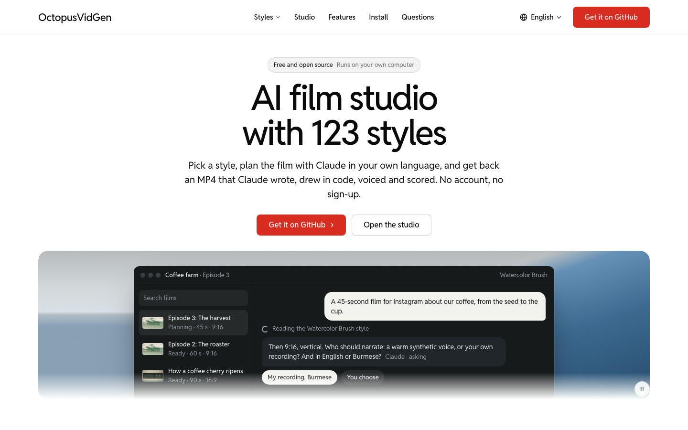
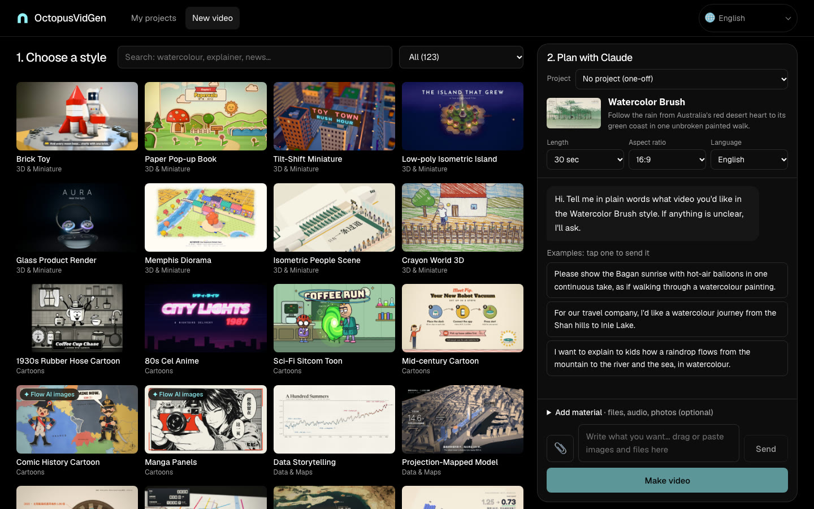
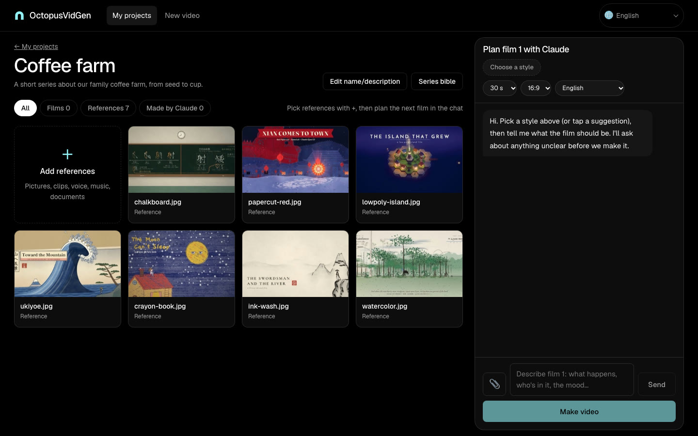
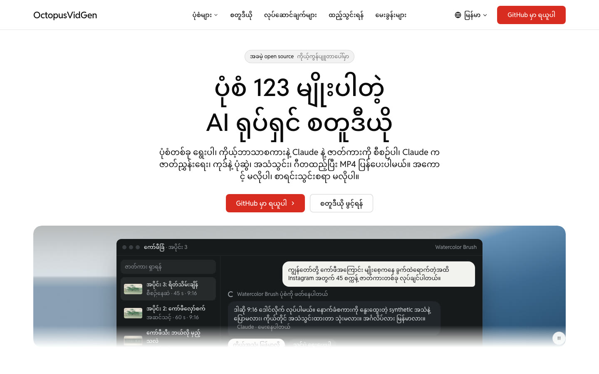
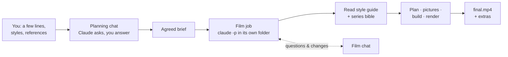

<div align="center">

# 🐙 OctopusVidGen

**A free, open-source AI film studio that runs on your own computer.**
Pick from 123 film styles, plan the film with Claude in your own language,
and get back an MP4 that Claude wrote, drew in code, voiced and scored.

[](LICENSE)




</div>

---

## Contents

- [What it does](#what-it-does)
- [Screenshots](#screenshots)
- [How a film gets made](#how-a-film-gets-made)
- [Install](#install)
- [Configuration](#configuration)
- [Using it](#using-it)
- [Safety](#safety)
- [Project layout](#project-layout)
- [Translations](#translations)
- [Credits and references](#credits-and-references)
- [Licences](#licences)

## What it does

| | |
|---|---|
| 🎨 **123 film styles** | Watercolour, ink wash, ukiyo-e, risograph, chalkboard, blueprint, neon tubes, pixel RPG, 80s cel anime, rubber-hose cartoon, tilt-shift miniature, satellite briefing, exploded teardown, data stories, kinetic type, Lottie, logo reveals, a mixed-media documentary with real footage, and more, in 19 groups. |
| 💬 **Plan in a chat** | Before anything is made, Claude talks the film through with you in your language and asks what's unclear (at most two short rounds). You agree on a brief, then press **Make video**. |
| 🗂️ **Projects as a media board** | Like Google Flow: each project is a board of everything in it, including your references (pictures, clips, voice, music, documents), the films, and what Claude made for the series. Pick references with **+** and plan the next episode in the chat beside the board. |
| 🧪 **Blend styles** | Pick several styles for one film. The first one leads and the others lend their look, moves, type or sound. |
| ✦ **Style suggestions** | As you type, Claude suggests 4–6 styles that fit, each with one line on why. It uses a small, fast model. |
| 🎞️ **Series that remember** | Episodes in a project reuse the same characters, places, look and music. Claude keeps a series bible for each project. |
| 📎 **Your own material** | Drag or paste photos, logos, voice recordings, clips and data into the board or the chat. |
| 📈 **Watch it work** | A film page with a progress bar, the stages (read, plan, images, build, render, finish) and a chat. Claude can ask you a question mid-film, and you can ask for changes after. |
| 🌐 **15 languages** | English, 中文, မြန်မာ, ไทย, Español, हिन्दी, العربية, Português, Français, Deutsch, Русский, 日本語, 한국어, Tiếng Việt, Bahasa Indonesia. This covers the interface, the style descriptions, the sample wishes and Claude's chat. Arabic is laid out right to left. |
| 📐 **Any format** | 15–180 seconds; 16:9, 9:16, 1:1 or 4:5; narration in any of the 15 languages. Some styles also deliver an `.srt`, a thumbnail, SVG, HTML or Lottie JSON. |
| 🖼️ **Google Flow pictures** *(optional)* | Styles that need generated pictures (manga panels, comic history…) can make them with Google Flow in your own Chrome, through Claude in Chrome. |
| 🔓 **No account** | Nothing to sign up for. It runs on `127.0.0.1` with your own Claude Code: a Claude subscription or an API key. |

## Screenshots

<table>
<tr>
<td width="50%"><br><sub><b>New video:</b> choose a style, then plan with Claude. Sample wishes are in your language.</sub></td>
<td width="50%"><br><sub><b>Project board:</b> references, films and Claude's assets, with the planning chat beside them.</sub></td>
</tr>
<tr>
<td colspan="2"><br><sub>The whole site switches language. This is the landing page in Burmese.</sub></td>
</tr>
</table>

## How a film gets made



1. **Plan.** Each chat turn is one short `claude -p` call with no tools. It gets your messages, the style's guide, the project's series bible and your reference list. It returns a reply and the brief so far.
2. **Make.** The server queues a job. A worker runs Claude Code headless (`claude -p`, stream-json) in a folder of its own under `data/jobs/<id>/`. It links the film skills in and points it at the style's guide, your files and the project folder.
3. **Follow.** The film page reads the job's log for the progress stages and the chat. If Claude writes a question, the film page shows it. Your answer goes back to Claude, and you can resume a finished film to ask for changes.
4. **Keep.** The MP4 and any extras (`.srt`, thumbnail, SVG, Lottie JSON…) show on the film page. Assets worth reusing go into the project folder for the next episode.

## Install

### 1. What you need

| Tool | Version | Check | Get it |
|---|---|---|---|
| Rust (cargo) | stable | `cargo --version` | <https://rustup.rs> |
| Node.js | 20+ | `node --version` | <https://nodejs.org> |
| Python | 3.11–3.13 | `python3 --version` | <https://www.python.org> |
| ffmpeg | 7+ | `ffmpeg -version` | macOS: `brew install ffmpeg` · Ubuntu 24.04 ships 6.1, use a [static build](https://johnvansickle.com/ffmpeg/) |
| Claude Code | latest | `claude --version` | <https://claude.com/claude-code> |
| Google Chrome | any recent | | needed for rendering and for the optional Google Flow pictures |

Sign Claude Code in once: run `claude` and type `/login`. You can use a Claude subscription, or set `ANTHROPIC_API_KEY` in `server/.env` instead.

### 2. Get it and set it up

```bash
git clone --recurse-submodules --shallow-submodules https://github.com/MicroLand-Rkar/octopusvidgen.git
cd octopusvidgen
sh setup.sh
```

The skills are **git submodules**: they come straight from their authors' repositories (see [Credits](#credits-and-references)). If you cloned without `--recurse-submodules`, `setup.sh` fetches them for you.

`setup.sh` does the following:
- builds the web app (`web/app` → `web/app/dist`);
- builds the server (`cargo build --release`);
- creates `server/.env` from `server/.env.example`;
- installs what the film styles need: the Lemo-Opuscar packages (Node, a headless browser, Python, voices and music samples) and onetake's Python environment.

The first run downloads a few GB and takes a while. `sh setup.sh app` builds only the app and server.

### 3. Run it

```bash
sh run.sh
```

Open **<http://127.0.0.1:8787>**. The studio is at `/app/`.

### 4. Make real films

`server/.env` starts with **dry run on** (`OVG_DRY_RUN=1`), which makes a 5-second test video without calling Claude. When everything works, set:

```ini
OVG_DRY_RUN=0
```

and restart `sh run.sh`.

### 5. Stay up to date

```bash
sh update.sh
```

`update.sh` pulls OctopusVidGen and moves every skill in `engine/` to the **latest commit of its original repository**. Then it installs any new packages and rebuilds the app and server. On GitHub, Dependabot also opens a pull request each week when a skill has new commits upstream ([`.github/dependabot.yml`](.github/dependabot.yml)).

To pin a skill to a specific version: `cd engine/<skill> && git checkout <commit>`, then commit the new pointer in this repo.

### Developing

```bash
cd server && cargo run          # API on :8787
cd web/app && npm run dev       # app with hot reload on http://localhost:5173/app/
```

## Configuration

Everything is in `server/.env`. See [`server/.env.example`](server/.env.example) for the full list.

| Setting | Default | What it does |
|---|---|---|
| `PORT` | `8787` | Port on `127.0.0.1` |
| `OVG_DRY_RUN` | `1` in the example | `1` = 5-second ffmpeg test video, no Claude calls |
| `OVG_MAX_CONCURRENT_JOBS` | `1` | Films made at the same time |
| `CLAUDE_BIN` | `claude` | Path to the Claude Code CLI |
| `CLAUDE_MODEL` | CLI default | e.g. `claude-opus-5-5` |
| `CLAUDE_EFFORT` | `high` | Effort for film jobs |
| `ANTHROPIC_API_KEY` | none | Use an API key instead of a signed-in CLI |
| `OVG_IMAGE_TOOL` | `none` | `chrome-flow` = make pictures with Google Flow in your signed-in Chrome (Claude in Chrome extension) |
| `OVG_DATA_DIR` | `data/` | Where the database, films and projects live |

## Using it

1. **New video** (one-off) or **My projects → a project** (a series).
2. **Pick a style.** On a project board you can pick several: ★ leads, + blends in. You can also tap one of Claude's suggestions.
3. **Add references.** Drop files on the board and tick **+** on the ones this film should use.
4. **Plan.** Write what you want. Claude replies in your language, asks what's unclear and shows the brief.
5. **Make video.** Follow the stages on the film page, answer Claude if it asks, and download the MP4 and extras.

> Tip: change the interface language with 🌐 in the top bar. Claude chats in that language, and the narration language is chosen separately for each film.

## Safety

Film jobs run Claude Code with `--permission-mode bypassPermissions` in their own folder, so **Claude can run commands on your computer as you**. OctopusVidGen is built for one person on their own machine:

- The server listens on **`127.0.0.1` only**. It answers only its own pages (it checks `Host` and `Origin`), and every change needs an `X-OVG-Client` header. This stops other websites from starting films through your browser.
- **Don't expose it to a network or the internet.** There are no accounts.
- For a stronger wall, run it in a VM or container.
- Some styles can use short clips from other people's videos for commentary (the documentary style). Using them is your call and your responsibility on each platform.

## Project layout

```
octopusvidgen/
├── server/                 Rust API (axum 0.8 + SQLite via sqlx)
│   ├── src/
│   │   ├── jobs.rs         film queue, claude -p runner, the brief each film gets
│   │   ├── plan.rs         planning chat + style suggestions
│   │   ├── chat.rs         the film chat (questions, replies, resume)
│   │   ├── progress.rs     stages and progress from the job log
│   │   ├── projects.rs     projects, references, series bible
│   │   ├── styles.rs       the style catalogue
│   │   └── auth.rs         the local user + local-only request guard
│   ├── migrations/         SQLite schema
│   └── style_inputs.json   what material each style can take
├── web/
│   ├── app/                React + TypeScript studio (Vite), served at /app
│   │   └── src/i18n/       15 locale files (UI, style texts, sample wishes)
│   └── landing/            static landing page at /, with its own i18n/
├── engine/                 the film-making skills, one git submodule each (see Credits)
│   └── extra-styles/       styles from skills other than Lemo-Opuscar (ours)
├── .claude/skills/         links to the skills; each film folder links here
├── docs/img/               screenshots for this README
├── setup.sh · run.sh · update.sh
└── data/                   your database, films, projects (not in git)
```

## Translations

- **App:** `web/app/src/i18n/locales/<code>.json` has three parts. `ui` is the interface. `style` holds the style descriptions, field labels and hints, keyed by their English. `examples` holds three sample wishes per style, adapted to each language's places and festivals.
- **Landing page:** `web/landing/i18n/<code>.json`.
- Check a locale file with `python3 web/app/scripts/i18n-check.py web/app/src/i18n/locales/<code>.json`.

The translations were written with Claude and haven't been reviewed by native speakers yet. **Pull requests from native speakers are very welcome.**

## Credits and references

OctopusVidGen is the studio around these skills. The films are made by them:

| Skill | By | What it brings | Licence |
|---|---|---|---|
| [Lemo-Opuscar](https://github.com/lemomo-ai/lemo-opuscar) | Lemomo (LemoLab) | 99 film styles in code; the audio, voice and render toolkit | code MIT · style guides CC BY-NC 4.0 · stills CC BY 4.0 |
| [anidoodle](https://github.com/alexgreensh/anidoodle) | Alex Greenshpun | 13 illustrated animation styles, scores, narration | Apache 2.0 |
| [HyperFrames](https://github.com/heygen-com/hyperframes) | HeyGen | HTML-to-video: captions, music videos, vertical clips, documentary mixes | Apache 2.0 |
| [onetake](https://github.com/feitangyuan/onetake) | Patrick (feitangyuan) | launch films, feature demos and concept films with real motion blur | PolyForm Noncommercial 1.0.0 |
| [line-art-animation](https://github.com/JDhruv14/line-art-animation) | JDhruv14 | living line-art scenes in SVG | MIT |
| [text-to-lottie](https://github.com/diffusionstudio/lottie) | Diffusion Studio | Lottie animations from text | MIT |
| [pixel2motion](https://github.com/nolangz/pixel2motion) | Nolan Lai | logo to clean SVG to choreographed logo reveal | MIT |
| [Lanshu animated architecture diagram](https://github.com/cclank/lanshu-animated-architecture-diagram) | Lanshu | hand-drawn animated architecture diagrams | MIT |
| [screenwriting skills](https://github.com/jtydhr88/screenwriting-skills) | Terry Jia | story structure, scenes and dialogue for planning | MIT |

Built with [Claude Code](https://claude.com/claude-code), [axum](https://github.com/tokio-rs/axum), [sqlx](https://github.com/launchbadge/sqlx), [React](https://react.dev), [Vite](https://vite.dev), [ffmpeg](https://ffmpeg.org), [Playwright](https://playwright.dev), [edge-tts](https://github.com/rany2/edge-tts), [Kokoro](https://github.com/thewh1teagle/kokoro-onnx) and [faster-whisper](https://github.com/SYSTRAN/faster-whisper). The landing page was designed with the taste-skill design system. Its style stills come from Lemo-Opuscar (CC BY 4.0), anidoodle (Apache 2.0) and line-art-animation (MIT), or were drawn for this project; they are credited in the page footer.

## Licences

- **OctopusVidGen's own code** (`server/`, `web/`, scripts): [MIT](LICENSE).
- **The skills in `engine/`** keep their own licences (each folder has its `LICENSE`, and the table above lists them).
- ⚠️ **Non-commercial parts:** the Lemo-Opuscar style guides (CC BY-NC 4.0) and onetake (PolyForm Noncommercial) can't be used commercially without a licence from their authors. Styles under these terms carry an **NC** badge in the app. A free, personal or educational use is fine.
- **The films you make are yours.** Clips from other people's videos stay under their owners' rights.
